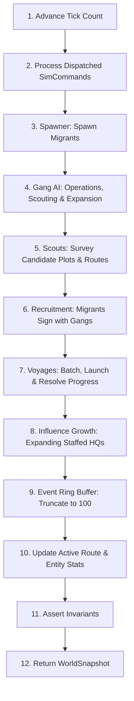

# Broke World — Simulation Architecture & Rules

Welcome to the **Broke World** simulation specification (`docs/sim/`). 

Broke World is a deterministic, headless, discrete-tick simulation of an autonomous smuggling network operating across three distinct geographical regions. In Broke World, autonomous criminal syndicates (Gangs) compete to operate transit routes, sign up migratory individuals (Migrants), and transport them via sea and land voyages from Africa and Europe into the United Kingdom.

---

## 🏛️ Simulation Core Principles

1. **Pure TypeScript Engine**:
   The entire simulation layer ([`src/sim/`](file:///c:/Users/Chris/src/playground/brokeworld/src/sim/)) has zero DOM or rendering dependencies (no Phaser, no Canvas, no window APIs). It can run in Node.js, Web Workers, or Vitest headless test environments.
2. **Determinism via Seeded PRNG**:
   All randomness is governed by an explicit pseudo-random number generator ([`src/sim/rng.ts`](file:///c:/Users/Chris/src/playground/brokeworld/src/sim/rng.ts)). Given identical seeds and command inputs, two simulation instances produce identical state trajectories across arbitrary tick counts.
3. **Decoupled Presentation**:
   Visuals and animations interpolate snapshot data provided via the [`GamePort`](file:///c:/Users/Chris/src/playground/brokeworld/src/app/GamePort.ts) interface. Presentation code never mutates simulation state or influences outcomes.
4. **Strict Invariant Verification**:
   The simulation enforces strict world invariants on every tick via [`assertInvariants()`](file:///c:/Users/Chris/src/playground/brokeworld/src/sim/invariants.ts). Any violation immediately throws an invariant failure.

---

## ⏱️ Time & Tick Lifecycle

### Time Scale Constants
- **Tick Interval**: `150ms` real time at `1×` speed ([`TickScheduler.ts`](file:///c:/Users/Chris/src/playground/brokeworld/src/app/TickScheduler.ts)).
- **Game Day**: 10 ticks = `1.5` real seconds.
- **AI Review Period**: 40 ticks = 4 game days (~6.0 seconds).
- **Supported Controls**:
  - `0×` (Paused)
  - `1×` (Normal Speed)
  - `5×` (Fast Speed)
  - `20×` (Ultra-fast Speed)
  - `⏯ Step`: Advances simulation by exactly 1 tick (`step()`)
  - `🔄 Reset`: Resets world, accumulator, and simulation state back to Tick 0 (Hotkey: `R`)
  - `🔥 Influence`: Toggles influence heat map visualization overlay (Hotkeys: `I` or `H`)

### Discrete Tick Update Order
Every tick in [`tickWorld()`](file:///c:/Users/Chris/src/playground/brokeworld/src/sim/tick.ts) executes operations in an explicit, sequential pipeline:

1. **Advance Tick**: Increment `state.tick += 1`.
2. **Process Commands**: Execute user commands (`PURCHASE_HQ`, `PURCHASE_NODE`, `PURCHASE_BORDER_ROUTE`, `HIRE_SCOUT`, `GANG_AID`).
3. **Migrant Spawning** ([`spawner.ts`](file:///c:/Users/Chris/src/playground/brokeworld/src/sim/spawner.ts)): Check population against cap (target: 30) and spawn new Migrants at valid source recruiters.
4. **Gang AI Evaluation** ([`ai.ts`](file:///c:/Users/Chris/src/playground/brokeworld/src/sim/ai.ts)): Runs every 40 ticks to pay staff wages, verify solvency, purchase discovered routes, acquire candidate nodes, and revitalize extinct syndicates with 1 Main HQ.
5. **Scout Processing** ([`scouts.ts`](file:///c:/Users/Chris/src/playground/brokeworld/src/sim/scouts.ts)): Runs every 30 ticks for Scout Hoods to discover candidate plots and cross-border corridors.
6. **Recruitment Processing** ([`recruitment.ts`](file:///c:/Users/Chris/src/playground/brokeworld/src/sim/recruitment.ts)): Decrement patience of waiting Migrants, match waiting Migrants with owning gang route services, collect fares.
7. **Voyage Scheduling & Progress** ([`voyages.ts`](file:///c:/Users/Chris/src/playground/brokeworld/src/sim/voyages.ts)):
   - Check recruited passenger queues and launch voyages (max 2 concurrent per route).
   - Advance progress of in-flight voyages.
   - Resolve arrivals (`SUCCESS`) or disruptions (`INTERCEPTED` / `CANCELLED`).
8. **Influence Growth** ([`influence.ts`](file:///c:/Users/Chris/src/playground/brokeworld/src/sim/influence.ts)): Slowly expand influence radius of active staffed HQs every 20 ticks.
9. **Event Log Maintenance**: Prepend new events and truncate ring buffer to the last 100 entries to prevent memory leaks.
10. **Statistics Computation**: Update active routes count and aggregate statistics.
11. **Invariant Verification** ([`invariants.ts`](file:///c:/Users/Chris/src/playground/brokeworld/src/sim/invariants.ts)): Validate structural integrity of nodes, routes, voyages, hoods, and migrants.
12. **State Output**: Return the new immutable [`WorldSnapshot`](file:///c:/Users/Chris/src/playground/brokeworld/src/sim/types.ts).

---

## 🗺️ Simulation Elements Index

For in-depth simulation mechanics and mathematical rules, refer to each dedicated document:

| Element Document | Primary Entity | Core Simulation Rules Documented |
| :--- | :--- | :--- |
| **[Influence Zones & Territorial Expansion](file:///c:/Users/Chris/src/playground/brokeworld/docs/sim/influence.md)** | `InfluenceCheckResult`, `RegionBounds` | Distance decay, strict border/water cutoff, multi-HQ synergy boost, rival pushback ($\alpha=0.65$), infrastructure acquisition gating, water corridor boundaries. |
| **[Nodes & Locations](file:///c:/Users/Chris/src/playground/brokeworld/docs/sim/nodes.md)** | `LocationDef`, `OperationState` | Single Main HQ starting rule, hidden unowned candidate nodes, node kinds (`HQ`, `WORKSHOP`, `RECRUITER`, `DEPOT`), tile bindings, depot passenger retention. |
| **[Migrants](file:///c:/Users/Chris/src/playground/brokeworld/docs/sim/migrants.md)** | `MigrantState` | Spawning rates, population caps, origins & destinations, patience decay, fare payments, avatar generation, depot settlement. |
| **[Routes & Connections](file:///c:/Users/Chris/src/playground/brokeworld/docs/sim/routes.md)** | `RouteServiceState`, `PhysicalConnectionDef` | Recruiter-to-Depot only, single-gang ownership matching endpoints, 1 route max between node pairs, capacity, ticket pricing, upkeep. |
| **[Voyages & Transport](file:///c:/Users/Chris/src/playground/brokeworld/docs/sim/voyages.md)** | `VoyageState` | Passenger batching, 2-voyage concurrency limit, progress calculation, resolution odds, success retention, disruption recovery. |
| **[Hoods](file:///c:/Users/Chris/src/playground/brokeworld/docs/sim/hoods.md)** | `HoodState`, `HoodRole` | "No Hood, No Action" rule, mandatory node management, `SCOUT` role surveying, voyage skipper lifecycle, payroll wages. |
| **[Gangs & Syndicate AI](file:///c:/Users/Chris/src/playground/brokeworld/docs/sim/gangs.md)** | `GangState` | Gang identities, single-node start, 40-tick review cycle, wage formula, bankruptcy thresholds, automated expansion, single-HQ revitalization. |
| **[Simulation Invariants](file:///c:/Users/Chris/src/playground/brokeworld/docs/sim/invariants.md)** | `assertInvariants()` | Formal contract checked every tick, failure conditions, soak test criteria, and structural constraints. |
