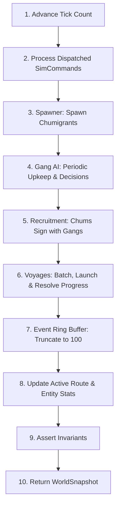

# Chum World — Simulation Architecture & Rules

Welcome to the **Chum World** simulation specification (`docs/sim/`). 

Chum World is a deterministic, headless, discrete-tick simulation of an autonomous smuggling network operating across three distinct geographical regions. In Chum World, autonomous criminal syndicates (Gangs) compete to operate transit routes, sign up migratory creatures (Chumigrants or "Chums"), and transport them via sea and land voyages from Africa and Europe into the United Kingdom.

---

## 🏛️ Simulation Core Principles

1. **Pure TypeScript Engine**:
   The entire simulation layer ([`src/sim/`](file:///c:/Users/chris/src/playground/chumworld/src/sim/)) has zero DOM or rendering dependencies (no Phaser, no Canvas, no window APIs). It can run in Node.js, Web Workers, or Vitest headless test environments.
2. **Determinism via Seeded PRNG**:
   All randomness is governed by an explicit pseudo-random number generator ([`src/sim/rng.ts`](file:///c:/Users/chris/src/playground/chumworld/src/sim/rng.ts)). Given identical seeds and command inputs, two simulation instances produce identical state trajectories across arbitrary tick counts.
3. **Decoupled Presentation**:
   Visuals and animations interpolate snapshot data provided via the [`GamePort`](file:///c:/Users/chris/src/playground/chumworld/src/app/GamePort.ts) interface. Presentation code never mutates simulation state or influences outcomes.
4. **Strict Invariant Verification**:
   The simulation enforces strict world invariants on every tick via [`assertInvariants()`](file:///c:/Users/chris/src/playground/chumworld/src/sim/invariants.ts). Any violation immediately throws an invariant failure.

---

## ⏱️ Time & Tick Lifecycle

### Time Scale Constants
- **Tick Interval**: `150ms` real time at `1×` speed ([`TickScheduler.ts`](file:///c:/Users/chris/src/playground/chumworld/src/app/TickScheduler.ts)).
- **Game Day**: 10 ticks = `1.5` real seconds.
- **AI Review Period**: 60 ticks = 6 game days (~9.0 seconds).
- **Supported Speeds**: `0×` (Paused), `1×` (Normal), `5×` (Fast), `20×` (Ultra-fast), plus single-tick stepping (`step()`).

### Discrete Tick Update Order
Every tick in [`tickWorld()`](file:///c:/Users/chris/src/playground/chumworld/src/sim/tick.ts) executes operations in an explicit, sequential pipeline:

1. **Advance Tick**: Increment `state.tick += 1`.
2. **Process Commands**: Execute external user or UI commands (e.g. `GANG_AID`).
3. **Chumigrant Spawning** ([`spawner.ts`](file:///c:/Users/chris/src/playground/chumworld/src/sim/spawner.ts)): Check population against cap (target: 30) and spawn new Chums at valid source recruiters.
4. **Gang AI Evaluation** ([`ai.ts`](file:///c:/Users/chris/src/playground/chumworld/src/sim/ai.ts)): Runs every 60 ticks to pay upkeep, assess solvency, re-establish broken routes, and revitalize extinct syndicates.
5. **Recruitment Processing** ([`recruitment.ts`](file:///c:/Users/chris/src/playground/chumworld/src/sim/recruitment.ts)): Decrement patience of waiting Chums, match waiting Chums with owning gang route services, collect fares.
6. **Voyage Scheduling & Progress** ([`voyages.ts`](file:///c:/Users/chris/src/playground/chumworld/src/sim/voyages.ts)):
   - Check recruited passenger queues and launch voyages (max 2 concurrent per route).
   - Advance progress of in-flight voyages.
   - Resolve arrivals (`SUCCESS`) or disruptions (`INTERCEPTED` / `CANCELLED`).
7. **Event Log Maintenance**: Prepend new events and truncate ring buffer to the last 100 entries to prevent memory leaks.
8. **Statistics Computation**: Update active routes count and aggregate statistics.
9. **Invariant Verification** ([`invariants.ts`](file:///c:/Users/chris/src/playground/chumworld/src/sim/invariants.ts)): Validate structural integrity of nodes, routes, voyages, and chums.
10. **State Output**: Return the new immutable [`WorldSnapshot`](file:///c:/Users/chris/src/playground/chumworld/src/sim/types.ts).

---

## 🗺️ Simulation Elements Index

For in-depth simulation mechanics and mathematical rules, refer to each dedicated document:

| Element Document | Primary Entity | Core Simulation Rules Documented |
| :--- | :--- | :--- |
| **[Nodes & Locations](file:///c:/Users/chris/src/playground/chumworld/docs/sim/nodes.md)** | `LocationDef`, `OperationState` | Node kinds (`HQ`, `WORKSHOP`, `RECRUITER`, `DEPOT`), single-gang ownership, regional constraints, tile bindings, depot passenger retention. |
| **[Chumigrants](file:///c:/Users/chris/src/playground/chumworld/docs/sim/chums.md)** | `ChumigrantState` | Spawning rates, population caps, origins & destinations, patience decay, fare payments, avatar generation, depot settlement. |
| **[Routes & Connections](file:///c:/Users/chris/src/playground/chumworld/docs/sim/routes.md)** | `RouteServiceState`, `PhysicalConnectionDef` | Recruiter-to-Depot only, single-gang ownership matching endpoints, 1 route max between node pairs, capacity, ticket pricing, upkeep. |
| **[Voyages & Transport](file:///c:/Users/chris/src/playground/chumworld/docs/sim/voyages.md)** | `VoyageState` | Passenger batching, 2-voyage concurrency limit, progress calculation, resolution odds, success retention, disruption recovery. |
| **[Chum Hoods](file:///c:/Users/chris/src/playground/chumworld/docs/sim/hoods.md)** | `HoodState`, `HoodRole` | "No Hood, No Action" rule, mandatory node management, voyage skipper lifecycle, HQ operative roster inspection. |
| **[Gangs & Syndicate AI](file:///c:/Users/chris/src/playground/chumworld/docs/sim/gangs.md)** | `GangState` | Gang identities, 60-tick review cycle, upkeep formula, bankruptcy thresholds, automatic route re-establishment, revitalization. |
| **[Simulation Invariants](file:///c:/Users/chris/src/playground/chumworld/docs/sim/invariants.md)** | `assertInvariants()` | Formal contract checked every tick, failure conditions, soak test criteria, and structural constraints. |
