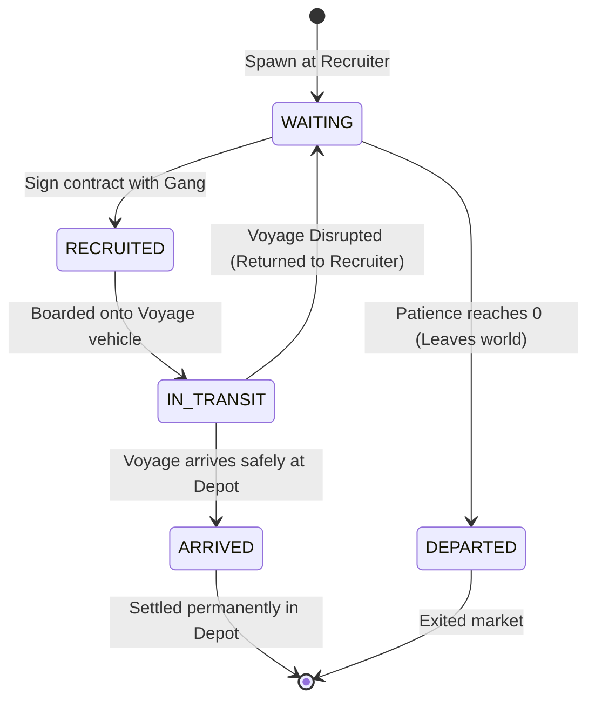

# Simulation Rules: Chumigrants (Chums)

**Chumigrants** (affectionately called "Chums") are the central autonomous agents navigating Chum World. Chums represent cute, simple aquatic creatures seeking transit from origin regions (North Africa and Western Europe) into destination sanctuaries (Europe or the United Kingdom).

Source code reference:
- Type definitions: [`ChumigrantState`](file:///c:/Users/chris/src/playground/chumworld/src/sim/types.ts#L93-L109) & [`ChumAvatarSpec`](file:///c:/Users/chris/src/playground/chumworld/src/sim/types.ts#L83-L91)
- Spawner logic: [`spawner.ts`](file:///c:/Users/chris/src/playground/chumworld/src/sim/spawner.ts)
- Recruitment logic: [`recruitment.ts`](file:///c:/Users/chris/src/playground/chumworld/src/sim/recruitment.ts)
- Verification logic: [`invariants.ts`](file:///c:/Users/chris/src/playground/chumworld/src/sim/invariants.ts#L87-L111)

---

## 🧬 Chum Entity State

Each Chum is tracked in the world snapshot dictionary `state.chumigrants[id]` with the following attributes:

```typescript
export interface ChumigrantState {
  id: string;                      // e.g. "CHUM_14"
  name: string;                    // e.g. "Pip Flounder"
  originName: string;              // e.g. "Tripoli", "Calais"
  originRegion: RegionId;          // 'AFRICA' | 'EUROPE'
  desiredRegion: 'EUROPE' | 'UK';  // Target region
  originId: string;                // Current location ID (Recruiter or Depot)
  cash: number;                    // Personal funds ($250 – $750)
  patienceRemainingTicks: number;  // Ticks remaining before giving up
  status: ChumStatus;              // Current lifecycle phase
  recruitedByGangId?: string;      // Contracted gang
  assignedRouteId?: string;        // Contracted route service
  voyageId?: string;               // Active voyage (if in transit)
  avatar: ChumAvatarSpec;          // Procedural visual features
  history: string[];               // Immutable chronological journey log
}
```

---

## 🔄 Chum Lifecycle & State Machine

Chums transition through six discrete states across their lifecycle:



### State Breakdown

| Status | Meaning | Location (`originId`) | Active In Transit Market? |
| :--- | :--- | :--- | :---: |
| **`WAITING`** | Waiting at a Recruiter node, evaluating available gang routes. Patience decays each tick. | `RECRUITER` node ID | ✅ Yes |
| **`RECRUITED`** | Has purchased a ticket and contracted with the node's owner gang. Waiting for voyage dispatch. | `RECRUITER` node ID | ✅ Yes |
| **`IN_TRANSIT`** | En route across a cross-border physical connection aboard a vehicle. | Source `RECRUITER` node ID | ✅ Yes |
| **`ARRIVED`** | Successfully completed voyage. **Safely housed inside target Depot**. | Target `DEPOT` node ID | ❌ No (Settled) |
| **`DEPARTED`** | Ran out of patience before finding passage; left the active migration pool. | Last known `RECRUITER` | ❌ No (Archived) |
| **`FAILED`** | Legacy terminal state for aborted migrations. | Last known node | ❌ No (Archived) |

---

## 🐣 Spawning Mechanics

Spawning is executed on every tick in [`spawnChumigrants()`](file:///c:/Users/chris/src/playground/chumworld/src/sim/spawner.ts):

### 1. Population Cap & Flow Throttling
- **Active Population**: Count of Chums with status `'WAITING'`, `'RECRUITED'`, or `'IN_TRANSIT'`.
- **Target Population**: `30` Chums.
- **Cap Rule**: If `activeChums.length >= 30`, spawning immediately halts.
- **Tick Rate Limit**: If population is below cap, a spawn check occurs with a **30% probability** (`prng.chance(0.3)`), preventing sudden population spikes.

### 2. Regional Origin & Destination Assignment
- **70% Chance — Africa Spawn**:
  - Origin region: `AFRICA`.
  - Origin city picked from: Tripoli, Tangier, Alexandria, Tunis, Algiers, Casablanca, Benghazi, Agadir.
  - Destination target: 50% seek `EUROPE`, 50% seek `UK`.
  - Node placement: Assigned to a randomly selected `RECRUITER` node located in `AFRICA`.
- **30% Chance — Europe Spawn**:
  - Origin region: `EUROPE`.
  - Origin city picked from: Calais, Marseille, Paris, Dunkirk, Lyon, Rotterdam, Bordeaux.
  - Destination target: 100% seek `UK`.
  - Node placement: Assigned to a randomly selected `RECRUITER` node located in `EUROPE`.

### 3. Financial & Patience Allocation
- **Cash**: Uniformly randomized between `$250` and `$750` (`prng.nextInt(250, 750)`).
- **Patience**: Uniformly randomized between `1,500` and `3,000` ticks (`prng.nextInt(1500, 3000)`). At 10 ticks per game day, this equates to 150 to 300 game days of tolerance.

---

## 📝 Recruitment Mechanics

Recruitment occurs in [`processRecruitment()`](file:///c:/Users/chris/src/playground/chumworld/src/sim/recruitment.ts) for all Chums currently in `WAITING` status:

### Step 1: Patience Decay
Each tick, waiting Chums lose 1 unit of patience:
```typescript
chum.patienceRemainingTicks -= 1;
if (chum.patienceRemainingTicks <= 0) {
  chum.status = 'DEPARTED';
  state.stats.activeChums--;
  state.stats.totalDepartedChums++;
  // Log departure...
}
```

### Step 2: Recruiter Owner Verification
- A Chum can only interact with the gang that owns their current `RECRUITER` location:
  ```typescript
  const recNode = state.locations[chum.originId];
  const gang = state.gangs[recNode.gangId];
  if (!gang || gang.status !== 'ACTIVE') return;
  ```

### Step 3: Route Compatibility Match
The owning gang must operate an `ACTIVE` route from this Recruiter to a Depot that satisfies the Chum's `desiredRegion`:
- If `chum.desiredRegion === 'EUROPE'`, target depot must be in `EUROPE`.
- If `chum.desiredRegion === 'UK'`, target depot may be in `UK` or in `EUROPE` (intermediate transit).

### Step 4: Financial Transaction & Gang Branded Clothing
If `chum.cash >= route.price`:
1. **Status Transition**: `chum.status = 'RECRUITED'`.
2. **Assignments**: `chum.recruitedByGangId = gang.id`, `chum.assignedRouteId = route.id`.
3. **Cash Flow**:
   - `chum.cash -= route.price`
   - `gang.cash += route.price`
   - `gang.stats.revenueTotal += route.price`
   - `route.revenue += route.price`
   - `gang.stats.recruitsTotal += 1`
4. **Visual Uniform**: The Chum puts on the syndicate's official colors:
   ```typescript
   chum.avatar.shirtColor = gang.color;
   ```
5. **History Entry**: Recorded into `chum.history`.

---

## 🛑 Disrupted Voyage Recovery

If a voyage suffers a disruption (`INTERCEPTED` or `CANCELLED`):
1. Passengers are **never deleted or harmed**.
2. All passengers revert to `status = 'WAITING'`.
3. Passenger assignments are cleared (`recruitedByGangId`, `assignedRouteId`, `voyageId` reset).
4. Passenger patience is penalized:
   ```typescript
   chum.patienceRemainingTicks = Math.max(300, chum.patienceRemainingTicks - 200);
   ```
5. Chums remain at the source `RECRUITER` node to attempt future passage.

---

## 🎨 Procedural Avatar Generation

Each Chum has a unique, deterministic visual representation generated during spawning:
- **Skin Tone**: 7 pastel tones (`#fed7aa`, `#fef08a`, `#cbd5e1`, `#fbcfe8`, `#bfdbfe`, `#bbf7d0`).
- **Shirt Color**: Initial random color from 7 options; replaced by syndicate color upon recruitment.
- **Hair Style & Color**: Bald, short, curly, or beanie across 5 color tones (black, brown, amber, silver, red).
- **Facial Features**: Dots, sleepy, wide, or winking eyes; smiling, neutral, or open mouth.
- **Luggage**: Briefcase, backpack, bundle, or none.
