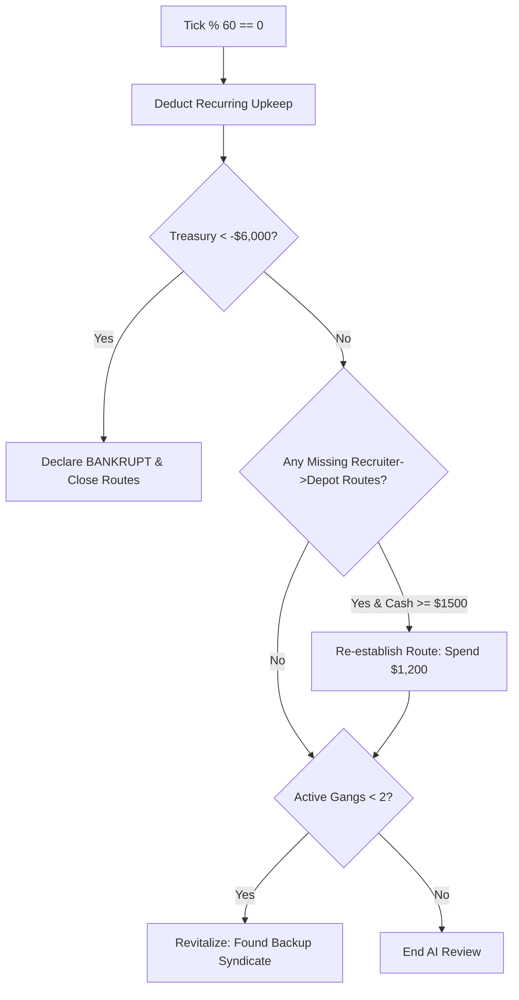

# Simulation Rules: Gangs & Syndicate AI

**Gangs** (represented by [`GangState`](file:///c:/Users/chris/src/playground/chumworld/src/sim/types.ts#L34-L55)) are autonomous criminal enterprises competing to control passenger transit corridors across Chum World.

Source code reference:
- Type definitions: [`GangState`](file:///c:/Users/chris/src/playground/chumworld/src/sim/types.ts#L34-L55)
- Syndicate creation: [`createWorld.ts`](file:///c:/Users/chris/src/playground/chumworld/src/sim/createWorld.ts#L245-L318)
- AI decision loop: [`ai.ts`](file:///c:/Users/chris/src/playground/chumworld/src/sim/ai.ts)

---

## 🏴 Active & Backup Syndicates

Each syndicate maintains a distinct brand identity, color scheme, emblem symbol, and operating territory:

| Gang ID | Name | Color | Hex | Emblem | Starting Cash | Starting Rep |
| :--- | :--- | :--- | :---: | :---: | :---: | :---: |
| **`GANG_NEON_GILL`** | Neon Gill Syndicate | Cyan | `#06b6d4` | `✦` | `$18,000` | 75 / 100 |
| **`GANG_CRIMSON_CLAW`** | Crimson Claw | Red | `#ef4444` | `▲` | `$19,000` | 70 / 100 |
| **`GANG_AMBER_FIN`** | Amber Fin Cartel | Amber | `#f59e0b` | `◆` | `$20,000` | 80 / 100 |

### Reserve Syndicates (Revitalization Pool)
If syndicate bankruptcies reduce the active gang count below 2, reserve syndicates are autonomously founded:
- **`GANG_ABYSSAL_TIDE`** (Abyssal Tide): Royal Purple (`#a855f7`, `⬡`)
- **`GANG_EMERALD_CORAL`** (Emerald Coral): Emerald Green (`#10b981`, `✿`)

---

## 🧠 Autonomous AI Decision Loop

Every gang periodically reviews its finances, infrastructure, and route health in [`processGangAI()`](file:///c:/Users/chris/src/playground/chumworld/src/sim/ai.ts#L11).

### Evaluation Frequency
- **Review Period**: Evaluated every **60 ticks** (`tick % 60 === 0`), equivalent to 6 game days (~9 real seconds at 1× speed).
- Rate-limiting prevents rapid economic swings and gives players time to observe cause and effect.



---

## 💵 Economic Balance & Upkeep Formula

### 1. Fixed and Variable Operational Upkeep
On every 60-tick review cycle, active syndicates pay operating costs:
$$\text{Total Upkeep} = \$45\ (\text{base HQ overhead}) + (\$30 \times \text{number of active routes})$$

### 2. Revenue Inflow
- Each time a Chumigrant signs a travel contract at an owned `RECRUITER` node, the ticket price ($270 to $350) is deposited directly into the gang's cash reserve:
  ```typescript
  gang.cash += route.price;
  gang.stats.revenueTotal += route.price;
  gang.stats.recruitsTotal += 1;
  ```

### 3. Insolvency & Bankruptcy Threshold
- If a gang's debts accumulate to **less than $-\$6,000$** (`gang.cash < -6000`):
  1. `gang.status = 'BANKRUPT'`.
  2. All active route services owned by the gang transition to `'CLOSING'`.
  3. High-importance event emitted: `GANG_BANKRUPT`.
  4. Decision logged in dossier: `"Severe debt exceeded credit limit."`.

---

## 🔄 Syndicate Revitalization Rule

To ensure the world remains vibrant and self-sustaining across long soak runs:
1. When active gangs drop below 2 (`activeGangs.length < 2`), the AI checks the reserve syndicate pool.
2. The AI provisions the newly activated syndicate with:
   - Starting treasury of **`$18,000`** and reputation of **`75`**.
   - An `HQ` (Logistics Hub) and `WORKSHOP` (Industrial Press) in Europe.
   - A `RECRUITER` in Africa and a `DEPOT` in Europe (with connecting Sea Route).
   - A `RECRUITER` in Europe and a `DEPOT` in the UK (with connecting Channel Route).
3. The new syndicate immediately begins competing in the travel market.

---

## 📈 Reputation Dynamics

Each gang tracks reputation on a scale of `0` to `100`:
- **Successful Voyage**: Gains **`+1`** reputation point (up to maximum 100).
- **Cancelled Voyage**: Loses **`-4`** reputation points (floor of 10).
- **Intercepted Voyage**: Loses **`-8`** reputation points (floor of 10).

Higher reputation strengthens syndicate prestige and public standing in the underworld hierarchy.

---

## 📖 Decision Journal & Observability

Every syndicate maintains a rolling journal of its last 5 strategic decisions in `gang.recentDecisions`:
```typescript
export interface GangDecision {
  tick: number;
  action: string;
  reason: string;
}
```
Inspecting any gang in the right-hand Inspector drawer displays this chronological audit log, allowing observers to see why a gang expanded, paid debts, or collapsed.
