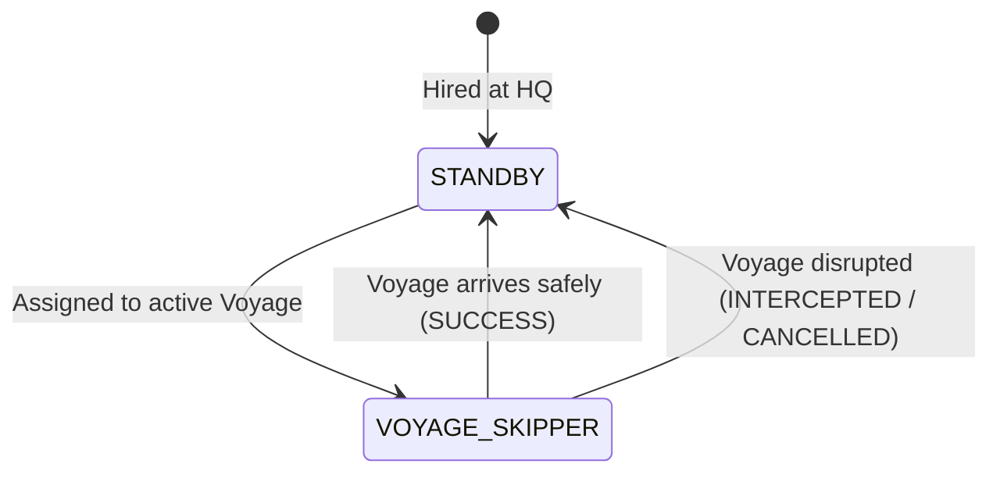

# Simulation Rules: Chum Hoods

**Chum Hoods** (represented by [`HoodState`](file:///c:/Users/chris/src/playground/chumworld/src/sim/types.ts#L138-L149)) are specialized operatives employed by syndicates to oversee facilities, conduct recruitment, and captain smuggling voyages.

Source code reference:
- Type definitions: [`HoodState`](file:///c:/Users/chris/src/playground/chumworld/src/sim/types.ts#L138-L149), [`HoodRole`](file:///c:/Users/chris/src/playground/chumworld/src/sim/types.ts#L125-L131), [`HoodAssignment`](file:///c:/Users/chris/src/playground/chumworld/src/sim/types.ts#L133-L137)
- Hood management module: [`hoods.ts`](file:///c:/Users/chris/src/playground/chumworld/src/sim/hoods.ts)
- Recruiter requirement: [`recruitment.ts`](file:///c:/Users/chris/src/playground/chumworld/src/sim/recruitment.ts#L29-L37)
- Voyage captaincy: [`voyages.ts`](file:///c:/Users/chris/src/playground/chumworld/src/sim/voyages.ts#L51-L71)
- Invariant verification: [`invariants.ts`](file:///c:/Users/chris/src/playground/chumworld/src/sim/invariants.ts#L113-L153)

---

## 🎩 Operational Mandate: "No Hood, No Action"

A syndicate cannot operate autonomously without its workforce of Chum Hoods:
1. **Recruitment requires a Hood**:
   A `RECRUITER` location cannot sign up Chumigrants unless an active Hood is assigned as `RECRUITER_MANAGER`. Unstaffed recruiter nodes remain dormant.
2. **Voyages require a Hood**:
   Every voyage dispatched across the Mediterranean or English Channel requires an assigned Hood acting as `VOYAGE_SKIPPER`. Voyages cannot launch without a skipper.
3. **Nodes require management**:
   Gang `HQ`, `WORKSHOP`, and `DEPOT` facilities require dedicated Hoods (`HQ_BOSS`, `WORKSHOP_MECHANIC`, `DEPOT_GUARD`) to oversee security and fleet readiness.
4. **Hiring Cost Policy**:
   Currently, syndicates hire Hoods free of monetary charge (`"for now gangs just hire hoods no money for now"`). Hoods are automatically provisioned on world initialization, during AI expansion, and on-demand when launching voyages.

---

## 👔 Hood Roles & Assignments

| Role | Default Assignment | Function & Activity |
| :--- | :--- | :--- |
| **`HQ_BOSS`** | `MANAGE_NODE` (HQ location) | Directs high-level syndicate operations and monitors treasury. |
| **`RECRUITER_MANAGER`** | `MANAGE_NODE` (Recruiter location) | Manages ticket desk and recruits waiting Chumigrants. |
| **`DEPOT_GUARD`** | `MANAGE_NODE` (Depot location) | Secures safehouse and oversees permanently housed Chums. |
| **`WORKSHOP_MECHANIC`** | `MANAGE_NODE` (Workshop location) | Maintains smuggling vessels and mechanical equipment. |
| **`VOYAGE_SKIPPER`** | `PILOT_VOYAGE` (Voyage ID) | Commands vessel in transit; tracks live progress percentage. |
| **`STANDBY`** | `IDLE_HQ` (HQ location) | Stationed at gang HQ ready for next voyage dispatch or reassignment. |

---

## 🔍 HQ Inspection & Observability

When an observer selects an **HQ Node** on the map:
- The right-hand Inspector drawer opens to the `LOCATION DOSSIER`.
- A dedicated **EMPLOYED CHUM HOODS** panel displays every Hood currently on the gang's payroll.
- Each entry shows:
  - **Procedural Avatar**: Distinctive beanies, facial expressions, and gang-colored shirts.
  - **Rank & Name**: Generated title and name (e.g., `Boss Barnaby Flounder`, `Skipper Pebble Bass`).
  - **Role Badge**: High-contrast rank pill (`HQ BOSS`, `RECRUITER MANAGER`, `VOYAGE SKIPPER`, etc.).
  - **Live Duty Status**: Real-time description of what they are currently doing:
    - *"Directing syndicate operations at Neon European HQ"*
    - *"Signing up Chums and managing intake at Neon Tripoli Recruiter"*
    - *"Skippering boat voyage to Marseille Depot (58%)"*
    - *"Standing by at Neon European HQ ready for dispatch"*

### Node & Voyage Cross-Inspection
- **Recruiters, Workshops & Depots**: Inspecting any non-HQ location displays the `MANAGING HOOD` currently stationed there.
- **Voyages**: Inspecting any in-progress vessel displays the `VOYAGE SKIPPER` steering the crossing.

---

## 🔄 Voyage Skipper Lifecycle

1. **Dispatch**: When a route reaches capacity or launches with recruited Chums, an idle `STANDBY` Hood is assigned as skipper. If none are idle, a new skipper is hired.
2. **Transit**: Hood's task description dynamically tracks progress (e.g., `Skippering boat voyage to Dover Depot (72%)`).
3. **Return**: Upon resolution (`SUCCESS`, `INTERCEPTED`, or `CANCELLED`), the Hood returns safely to HQ as `STANDBY`.
