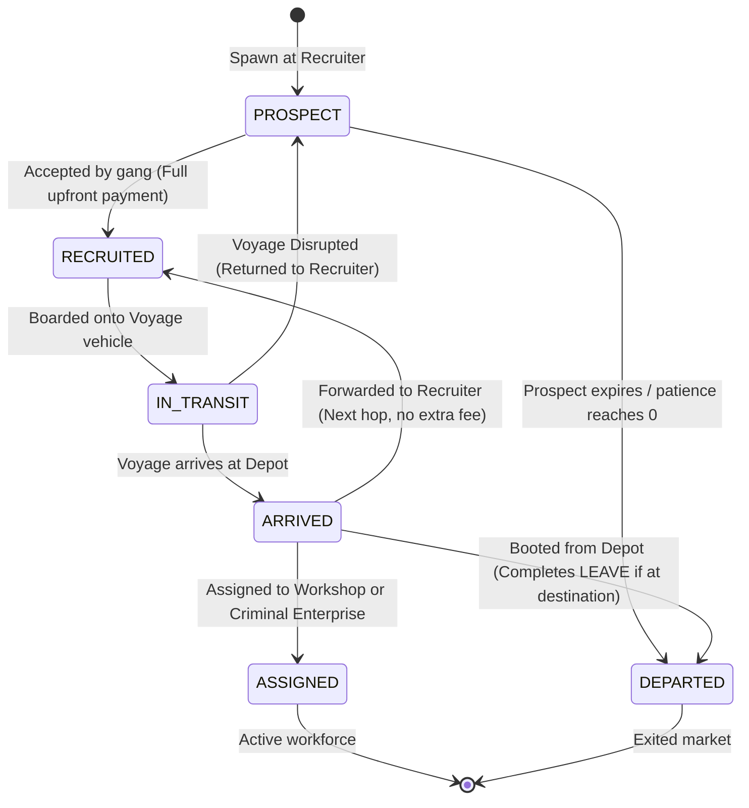

# Simulation Rules: Migrants

**Migrants** are the central autonomous agents navigating Broke World. Migrants represent people seeking transit from origin regions (North Africa and Western Europe) into destination sanctuaries (Europe or the United Kingdom).

Source code reference:
- Type definitions: [`MigrantState`](file:///c:/Users/Chris/src/playground/brokeworld/src/sim/types.ts) & [`MigrantAvatarSpec`](file:///c:/Users/Chris/src/playground/brokeworld/src/sim/types.ts)
- Spawner logic: [`spawner.ts`](file:///c:/Users/Chris/src/playground/brokeworld/src/sim/spawner.ts)
- Recruitment logic: [`recruitment.ts`](file:///c:/Users/Chris/src/playground/brokeworld/src/sim/recruitment.ts)
- Verification logic: [`invariants.ts`](file:///c:/Users/Chris/src/playground/brokeworld/src/sim/invariants.ts)

---

## 🧬 Migrant Entity State

Each Migrant is tracked in the world snapshot dictionary `state.migrants[id]` with the following attributes:

```typescript
export interface MigrantState {
  id: string;                      // e.g. "MIGRANT_14"
  name: string;                    // e.g. "Pip Flounder"
  originName: string;              // e.g. "Tripoli", "Calais"
  originRegion: RegionId;          // 'AFRICA' | 'EUROPE'
  desiredRegion: 'EUROPE' | 'UK';  // Target region
  originId: string;                // Current location ID (Recruiter, Depot, Workshop)
  destinationId?: string;          // Persistent final destination node
  destinationRegion?: RegionId;    // Region of final destination
  goal?: MigrantGoal;              // 'LEAVE' | 'WORK' | 'CRIME' | 'MARRY'
  happiness?: number;              // 0–100 happiness index
  offer?: number;                  // Upfront monetary offer for entire journey
  originRecruiterId?: string;      // Recruiter node where migrant first appeared
  destinationReached?: boolean;    // Whether final destination node was physically reached
  goalFulfilled?: boolean;         // Whether life goal was fulfilled at final destination
  prospectExpiresTick?: number;    // Expiration tick for unaccepted prospects
  cash: number;                    // Personal funds
  patienceRemainingTicks: number;  // Ticks remaining before giving up
  status: MigrantStatus;           // Current lifecycle phase
  recruitedByGangId?: string;      // Contracted gang
  assignedRouteId?: string;        // Contracted route service
  voyageId?: string;               // Active voyage (if in transit)
  avatar: MigrantAvatarSpec;       // Procedural visual features
  history: string[];               // Immutable chronological journey log
}
```

---

## 🔄 Migrant Lifecycle & State Machine

Migrants transition through discrete states across their lifecycle:



### State Breakdown

| Status | Meaning | Location (`originId`) | Active In Transit Market? |
| :--- | :--- | :--- | :---: |
| **`PROSPECT` / `WAITING`** | Available at recruiter node with upfront monetary offer. Expiration / patience decays each tick. | `RECRUITER` node ID | ✅ Yes |
| **`RECRUITED`** | Accepted by gang syndicate; upfront offer collected in full. Awaiting voyage departure or next hop. | `RECRUITER` node ID | ✅ Yes |
| **`IN_TRANSIT` / `TRAVELLING`** | En route across a single-hop cross-border route aboard a vehicle. | Source `RECRUITER` node ID | ✅ Yes |
| **`ARRIVED` / `AT_DEPOT`** | Safely housed inside target `DEPOT`. Eligible for forwarding, assignment, or booting. | Target `DEPOT` node ID | ❌ No (Housed) |
| **`ASSIGNED`** | Stationed as active workforce at a `WORKSHOP` or `CRIMINAL_ENTERPRISE`. | Production node ID | ❌ No (Employed) |
| **`DEPARTED` / `EXITED`** | Finished journey, expired, or booted from gang control. | Last known node | ❌ No (Archived) |

---

## 🐣 Spawning Mechanics

Spawning is executed on every tick in [`spawnMigrants()`](file:///c:/Users/Chris/src/playground/brokeworld/src/sim/spawner.ts):

### 1. Population Cap & Flow Throttling
- **Active Population**: Count of Migrants with status `'WAITING'`, `'RECRUITED'`, or `'IN_TRANSIT'`.
- **Target Population**: `30` Migrants.
- **Cap Rule**: If `activeMigrants.length >= 30`, spawning immediately halts.
- **Tick Rate Limit**: If population is below cap, a spawn check occurs with a **30% probability** (`prng.chance(0.3)`), preventing sudden population spikes.

### 2. Regional Origin & Destination Assignment
- **70% Chance — Africa Spawn**:
  - Origin region: `AFRICA`.
  - Origin city picked from: Tripoli, Tangier, Alexandria, Tunis, Algiers, Casablanca, Benghazi, Agadir.
  - Destination target: 50% seek `EUROPE`, 50% seek `UK`.
  - Node placement: Assigned to a randomly selected `RECRUITER` node located in `AFRICA`.
- **30% Chance — Europe Spawn**:
  - Origin region: `EUROPE`.
  - Origin city picked from: Calais, Marseille, Paris, Dunkirk, Lyon, Rotterdam, Bordeaux.
  - Destination target: 100% seek `UK`.
  - Node placement: Assigned to a randomly selected `RECRUITER` node located in `EUROPE`.

### 3. Financial & Patience Allocation
- **Cash**: Uniformly randomized between `$250` and `$750` (`prng.nextInt(250, 750)`).
- **Patience**: Uniformly randomized between `1,500` and `3,000` ticks (`prng.nextInt(1500, 3000)`). At 10 ticks per game day, this equates to 150 to 300 game days of tolerance.

---

## 📝 Recruitment Mechanics

Recruitment occurs in [`processRecruitment()`](file:///c:/Users/Chris/src/playground/brokeworld/src/sim/recruitment.ts) for all Migrants currently in `WAITING` status:

### Step 1: Patience Decay
Each tick, waiting Migrants lose 1 unit of patience:

```typescript
migrant.patienceRemainingTicks -= 1;
if (migrant.patienceRemainingTicks <= 0) {
  migrant.status = 'DEPARTED';
  state.stats.activeMigrants--;
  state.stats.totalDepartedMigrants++;
  // Log departure...
}
```

### Step 2: Recruiter Owner Verification
- A Migrant can only interact with the gang that owns their current `RECRUITER` location:
  ```typescript
  const recNode = state.locations[migrant.originId];
  const gang = state.gangs[recNode.gangId];
  if (!gang || gang.status !== 'ACTIVE') return;
  ```

### Step 3: Route Compatibility Match
The owning gang must operate an `ACTIVE` route from this Recruiter to a Depot that satisfies the Migrant's `desiredRegion`:
- If `migrant.desiredRegion === 'EUROPE'`, target depot must be in `EUROPE`.
- If `migrant.desiredRegion === 'UK'`, target depot may be in `UK` or in `EUROPE` (intermediate transit).

### Step 4: Financial Transaction & Gang Branded Clothing
If `migrant.cash >= route.price`:
1. **Status Transition**: `migrant.status = 'RECRUITED'`.
2. **Assignments**: `migrant.recruitedByGangId = gang.id`, `migrant.assignedRouteId = route.id`.
3. **Cash Flow**:
   - `migrant.cash -= route.price`
   - `gang.cash += route.price`
   - `gang.stats.revenueTotal += route.price`
   - `route.revenue += route.price`
   - `gang.stats.recruitsTotal += 1`
4. **Visual Uniform**: The Migrant puts on the syndicate's official colors:
   ```typescript
   migrant.avatar.shirtColor = gang.color;
   ```
5. **History Entry**: Recorded into `migrant.history`.

---

## 🛑 Disrupted Voyage Recovery

If a voyage suffers a disruption (`INTERCEPTED` or `CANCELLED`):
1. Passengers are **never deleted or harmed**.
2. All passengers revert to `status = 'WAITING'`.
3. Passenger assignments are cleared (`recruitedByGangId`, `assignedRouteId`, `voyageId` reset).
4. Passenger patience is penalized:
   ```typescript
   migrant.patienceRemainingTicks = Math.max(300, migrant.patienceRemainingTicks - 200);
   ```
5. Migrants remain at the source `RECRUITER` node to attempt future passage.

---

## 🎨 Procedural Avatar Generation

Each Migrant has a unique, deterministic visual representation generated during spawning:
- **Skin Tone**: 7 pastel tones (`#fed7aa`, `#fef08a`, `#cbd5e1`, `#fbcfe8`, `#bfdbfe`, `#bbf7d0`).
- **Shirt Color**: Initial random color from 7 options; replaced by syndicate color upon recruitment.
- **Hair Style & Color**: Bald, short, curly, or beanie across 5 color tones (black, brown, amber, silver, red).
- **Facial Features**: Dots, sleepy, wide, or winking eyes; smiling, neutral, or open mouth.
- **Luggage**: Briefcase, backpack, bundle, or none.
