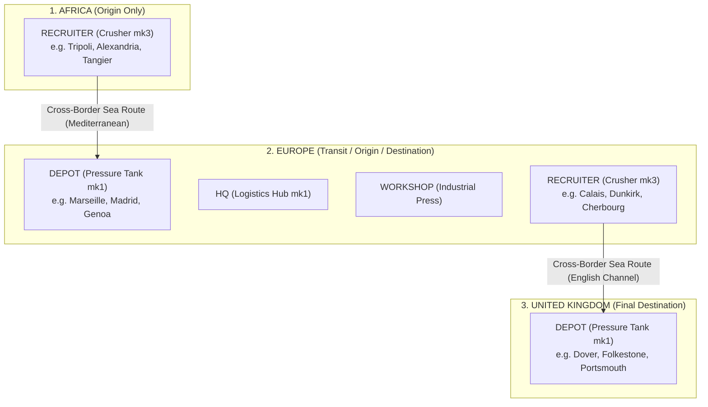

# Simulation Rules: Nodes & Locations

Nodes represent fixed geographical infrastructure points in the Chum World simulation. All operational facilities, recruitment hubs, and transport terminals are modeled as nodes.

Source code reference:
- Type definitions: [`LocationDef`](file:///c:/Users/chris/src/playground/chumworld/src/sim/types.ts#L7-L17) & [`OperationState`](file:///c:/Users/chris/src/playground/chumworld/src/sim/types.ts#L57-L64)
- World generator: [`createWorld.ts`](file:///c:/Users/chris/src/playground/chumworld/src/sim/createWorld.ts#L20-L224)
- Verification logic: [`invariants.ts`](file:///c:/Users/chris/src/playground/chumworld/src/sim/invariants.ts#L4-L28)

---

## 🏗️ Node Kinds & Specifications

Every node belongs to exactly one of four functional kinds, each bound to a specific visual tile family:

| Kind | Purpose | Tile Family | Default Variant | Permitted Regions | Can Recruit Chums? | Can Host Routes? |
| :--- | :--- | :--- | :--- | :--- | :---: | :---: |
| **`HQ`** | Central syndicate command post. | `logistics-hub` | `mk1` | `EUROPE` | ❌ No | ❌ No |
| **`WORKSHOP`** | Fleet staging and mechanical maintenance. | `industrial-press` | `mk1-north` | `EUROPE` | ❌ No | ❌ No |
| **`RECRUITER`** | Commercial origin depot where Chumigrants assemble and purchase passage. | `crusher` | `mk3` | `AFRICA`, `EUROPE` | ✅ **Yes** | ✅ **Source Only** |
| **`DEPOT`** | Safe-house terminal where voyages arrive and Chums permanently settle. | `pressure-tank` | `mk1-north` | `EUROPE`, `UK` | ❌ No | ✅ **Target Only** |

### Visual Tile Family Mappings
Simulation invariant checks enforce that tile families correspond strictly to node kinds:
```typescript
if (loc.kind === 'RECRUITER' && loc.tileFamily !== 'crusher') throw new Error(...);
if (loc.kind === 'DEPOT' && loc.tileFamily !== 'pressure-tank') throw new Error(...);
if (loc.kind === 'HQ' && loc.tileFamily !== 'logistics-hub') throw new Error(...);
if (loc.kind === 'WORKSHOP' && loc.tileFamily !== 'industrial-press') throw new Error(...);
```

---

## 🔒 Gang Ownership Rules

1. **Strict Monopolistic Ownership**:
   Every node in the simulation contains a mandatory `gangId` property. Neutral or shared operational nodes are **strictly forbidden**.
   ```typescript
   export interface LocationDef {
     id: string;
     name: string;
     region: RegionId;
     x: number;
     y: number;
     tileFamily: string;
     tileVariant: string;
     kind: LocationKind;
     gangId: string; // Mandatory owner
   }
   ```
2. **Owner-Exclusivity for Commercial Operations**:
   - Only the gang that owns a `RECRUITER` node may sign up Chums waiting at that location.
   - Only the gang that owns both the source `RECRUITER` and the destination `DEPOT` may operate a route connecting them. Foreign gangs cannot lease or route through competitor nodes.
3. **HQ Persistence**:
   Each active gang maintains exactly one `HQ` node. Dissolving a gang removes or bankrupts associated operations, but during active status, the HQ is non-negotiable.

---

## 🌍 Regional Hierarchy & Migration Flow

The world map is divided into three geographical tiers. Migration flows strictly in a South-to-North direction:



### Regional Role Constraints
- **`AFRICA`**: Origin territory. Contains `RECRUITER` nodes only. Chums spawn here seeking passage to `EUROPE` or `UK`.
- **`EUROPE`**: Central operating hub. Contains:
  - `DEPOT` nodes (receiving passengers crossing the Mediterranean from Africa).
  - Gang `HQ` and `WORKSHOP` nodes.
  - `RECRUITER` nodes (origin points for Channel crossings into the UK).
- **`UK`**: Final destination sanctuary. Contains `DEPOT` nodes only. Voyages terminate here.

---

## 🏠 The Depot Passenger Retention Rule

A foundational rule of Chum World is **passenger retention**:
- When a voyage successfully completes, passenger Chums are **not deleted** or despawned from the simulation.
- Instead, each Chum transitions to status `'ARRIVED'` and their `originId` is permanently set to the destination `DEPOT` node ID.
- The Chum remains safely housed inside the depot for the rest of the game session, archived in memory with their complete journey history.
- Inspection of any Depot node reveals the roster of all successfully resettled Chums residing within that facility.

---

## ⚡ Physical Connections Between Nodes

Physical connections ([`PhysicalConnectionDef`](file:///c:/Users/chris/src/playground/chumworld/src/sim/types.ts#L19-L26)) define underlying geographical travel corridors:
1. **Recruiter-to-Depot Only**: A physical connection can only be established from a `RECRUITER` node to a `DEPOT` node.
2. **Cross-Border Mandatory**: All active connections must have `isCrossBorder: true`. Intra-region domestic links do not exist in the MVP simulation.
3. **Transport Medium**: Mode is designated as `'SEA'` (e.g. Mediterranean or English Channel crossings) or `'LAND'` (e.g. cross-border van links).
