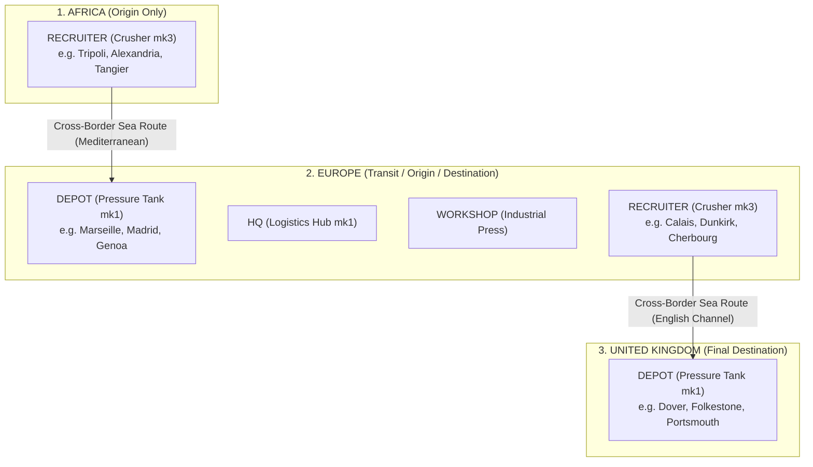

# Simulation Rules: Nodes & Locations

Nodes represent fixed geographical infrastructure points in the Chum World simulation. All operational facilities, recruitment hubs, and transport terminals are modeled as nodes.

Source code reference:
- Type definitions: [`LocationDef`](file:///c:/Users/chris/src/playground/chumworld/src/sim/types.ts#L7-L17) & [`OperationState`](file:///c:/Users/chris/src/playground/chumworld/src/sim/types.ts#L57-L64)
- World generator: [`createWorld.ts`](file:///c:/Users/chris/src/playground/chumworld/src/sim/createWorld.ts#L20-L224)
- Verification logic: [`invariants.ts`](file:///c:/Users/chris/src/playground/chumworld/src/sim/invariants.ts#L4-L28)

---

## 🏗️ Node Kinds & Specifications

Every node belongs to exactly one of four functional kinds, each bound to a specific visual tile family:

| Kind | Purpose | Tile Family | Default Variant | Permitted Regions | Can Recruit Chums? | Can Host Routes? |
| :--- | :--- | :--- | :--- | :--- | :---: | :---: |
| **`HQ`** | Central syndicate command post & regional influence emitter. | `logistics-hub` | `mk1` | `AFRICA`, `EUROPE`, `UK` | ❌ No | ❌ No |
| **`WORKSHOP`** | Fleet staging, mechanic shop & labor destination. | `industrial-press` | `mk1-north` | `EUROPE` | ❌ No | ✅ **Target Only** (from same-region Depot) |
| **`RECRUITER`** | Commercial origin depot where Chumigrants assemble and purchase passage. | `crusher` | `mk3` | `AFRICA`, `EUROPE` | ✅ **Yes** | ✅ **Source Only** (to Depot) |
| **`DEPOT`** | Safe-house terminal where voyages arrive and Chums assemble before workshop transfer. | `pressure-tank` | `mk1-north` | `EUROPE`, `UK` | ❌ No | ✅ **Target** (from Recruiter) & **Source** (to Workshop) |

### Visual Tile Family Mappings
Simulation invariant checks enforce that tile families correspond strictly to node kinds:
```typescript
if (loc.kind === 'RECRUITER' && loc.tileFamily !== 'crusher') throw new Error(...);
if (loc.kind === 'DEPOT' && loc.tileFamily !== 'pressure-tank') throw new Error(...);
if (loc.kind === 'HQ' && loc.tileFamily !== 'logistics-hub') throw new Error(...);
if (loc.kind === 'WORKSHOP' && loc.tileFamily !== 'industrial-press') throw new Error(...);
```

---

## 🔒 Gang Ownership Rules

1. **Strict Monopolistic Ownership**:
   Every node in the simulation contains a mandatory `gangId` property. Neutral or shared operational nodes are **strictly forbidden**.
2. **Owner-Exclusivity for Commercial Operations**:
   - Only the gang that owns a `RECRUITER` node may sign up Chums waiting at that location.
   - Only the gang that owns both the source `RECRUITER` and the destination `DEPOT` may operate a route connecting them. Foreign gangs cannot lease or route through competitor nodes.
3. **Regional HQs & Influence Zones**:
   - Each active gang begins the simulation with an HQ in **each of the 3 regions** (`AFRICA`, `EUROPE`, `UK`).
   - The European HQ serves as the **Primary Main HQ** (`isMainHq: true`), housing the gang's Capo and reserve hoods on standby.
   - Additional regional branch HQs can be purchased ($4,000).

---

## ⚡ HQ Influence Zones & The Heat Map

Every gang HQ projects an area of influence (**Influence Zone / Heat Map**):

1. **Influence Dissipation**:
   - Influence heat is maximum ($1.0$, 100%) at the HQ epicenter and dissipates linearly with Euclidean distance up to a base radius of $R = 260\text{px}$.
   - Formula: $\text{heat}(d) = 1.0 - (d / R)$ for $d \le R$; otherwise $0.0$.
2. **Strict Regional Border Cutoff**:
   - **Heat maps strictly stop at international/maritime borders**: An HQ located in Europe projects zero influence into North Africa or the United Kingdom, even if the physical distance is within $260\text{px}$.
   - **Rule**: *To acquire operational nodes in a region, a gang must first own or purchase an HQ in that region.*
3. **Rival Gang Restriction & Slight Overlap**:
   - Rival gang HQs restrict and push back each other's influence zones.
   - A damped restriction factor ($\alpha = 0.65$) allows a slight, contested overlap buffer at the border where both gangs hold positive influence, while strong proximity to a rival HQ completely snuffs out competitor influence.
4. **Acquisition Gating & Future Stats Multiplier**:
   - Operational nodes (`RECRUITER`, `DEPOT`, `WORKSHOP`) can **only be purchased inside an active HQ heat map** ($\text{heat} \ge 0.05$).
   - Nodes gain a stats multiplier based on proximity heat: $\text{multiplier} = 1.0 + 0.5 \times \text{heat}$.
5. **Interactive UI Representation**:
   - Visualized on the world map with darker, saturated color tinting near the HQ that smoothly dissipates with distance.
   - View is toggleable via the HUD button `🔥 Influence` or hotkeys `I` and `H`.

---

## 🌍 Regional Hierarchy & Migration Flow

The world map is divided into three geographical tiers. Migration flows strictly in a South-to-North direction:



### Regional Role Constraints
- **`AFRICA`**: Origin territory. Contains `RECRUITER` nodes only. Chums spawn here seeking passage to `EUROPE` or `UK`.
- **`EUROPE`**: Central operating hub. Contains:
  - `DEPOT` nodes (receiving passengers crossing the Mediterranean from Africa).
  - Gang `HQ` and `WORKSHOP` nodes.
  - `RECRUITER` nodes (origin points for Channel crossings into the UK).
- **`UK`**: Final destination sanctuary. Contains `DEPOT` nodes only. Voyages terminate here.

---

## 🏠 The Depot Passenger Retention Rule

A foundational rule of Chum World is **passenger retention**:
- When a voyage successfully completes, passenger Chums are **not deleted** or despawned from the simulation.
- Instead, each Chum transitions to status `'ARRIVED'` and their `originId` is permanently set to the destination `DEPOT` node ID.
- The Chum remains safely housed inside the depot for the rest of the game session, archived in memory with their complete journey history.
- Inspection of any Depot node reveals the roster of all successfully resettled Chums residing within that facility.

---

## ⚡ Physical Connections Between Nodes

Physical connections ([`PhysicalConnectionDef`](file:///c:/Users/chris/src/playground/chumworld/src/sim/types.ts#L19-L26)) define underlying geographical travel corridors:
1. **Recruiter-to-Depot Only**: A physical connection can only be established from a `RECRUITER` node to a `DEPOT` node.
2. **Cross-Border Mandatory**: All active connections must have `isCrossBorder: true`. Intra-region domestic links do not exist in the MVP simulation.
3. **Transport Medium**: Mode is designated as `'SEA'` (e.g. Mediterranean or English Channel crossings) or `'LAND'` (e.g. cross-border van links).
