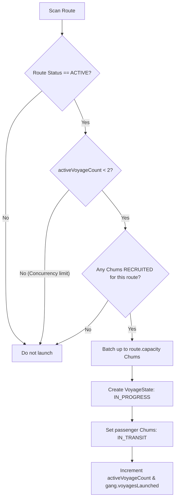

# Simulation Rules: Voyages & Vehicles

**Voyages** (represented by [`VoyageState`](file:///c:/Users/chris/src/playground/chumworld/src/sim/types.ts#L110-L122)) model individual active transit runs carrying passenger manifests of recruited Chumigrants across regional borders.

Source code reference:
- Type definitions: [`VoyageState`](file:///c:/Users/chris/src/playground/chumworld/src/sim/types.ts#L110-L122)
- Voyage loop & resolution: [`voyages.ts`](file:///c:/Users/chris/src/playground/chumworld/src/sim/voyages.ts)
- Visual interpolation: [`ChumScene.ts`](file:///c:/Users/chris/src/playground/chumworld/src/presentation/ChumScene.ts#L705-L770)
- Invariant verification: [`invariants.ts`](file:///c:/Users/chris/src/playground/chumworld/src/sim/invariants.ts#L68-L84)

---

## 🚀 Voyage Scheduling & Launch Criteria

Every simulation tick, [`processVoyages()`](file:///c:/Users/chris/src/playground/chumworld/src/sim/voyages.ts#L10) scans all active routes to determine if a new voyage should be launched:



### Launch Rules:
1. **Route Status**: The route service must be `'ACTIVE'`.
2. **Concurrency Limit**: Maximum **`2` active voyages simultaneously** per route service. If `route.activeVoyageCount >= 2`, launching is postponed until a current voyage resolves.
3. **Passenger Batching**:
   - Collects Chums currently marked `status === 'RECRUITED'` whose `assignedRouteId === route.id`.
   - Manifest batches up to `route.capacity` (e.g. 4 to 6 Chums).
   - Requires at least **1 recruited Chum** to launch. Empty "ghost runs" are never dispatched.
4. **State Transition**:
   - Voyage created with `status: 'IN_PROGRESS'`, `progress: 0.0`.
   - Passengers transition from `'RECRUITED'` to `'IN_TRANSIT'` with `chum.voyageId = voyage.id`.
   - Route `activeVoyageCount` increments by 1.
   - Owning gang's `stats.voyagesLaunched` increments by 1.

---

## ⏱️ Transit & Motion Progression

Voyage progress is simulated purely in discrete ticks:

$$\text{progress} = \min\left(1.0, \frac{\text{state.tick} - \text{voyage.startTick}}{\text{voyage.durationTicks}}\right)$$

### Visual Interpolation (60 FPS)
While the simulation calculates linear progress at 150ms per tick, [`ChumScene`](file:///c:/Users/chris/src/playground/chumworld/src/presentation/ChumScene.ts#L735-L745) renders smooth visual motion along the route's path:
$$\text{posX} = \text{src.x} + (\text{tgt.x} - \text{src.x}) \times \text{progress}$$
$$\text{posY} = \text{src.y} + (\text{tgt.y} - \text{src.y}) \times \text{progress}$$

The vehicle sprite (a boat or van) aligns rotation along the trajectory vector $\theta = \operatorname{atan2}(dy, dx)$ with passenger count badges and gang-colored accents.

---

## 🏁 Voyage Resolution & Outcomes

When `voyage.progress >= 1.0`, the voyage arrives and [`resolveVoyage()`](file:///c:/Users/chris/src/playground/chumworld/src/sim/voyages.ts#L90) determines the outcome based on route reliability:

```typescript
const baseReliability = route ? route.reliability : 0.97;
const isFailed = prng.chance(1 - baseReliability);
```

### 1. Success Outcome (97%–99% Probability)
When successful:
- **Voyage Status**: Becomes `'SUCCESS'`.
- **Gang Rewards**:
  - `gang.stats.voyagesSuccessful += 1`
  - `gang.reputation = Math.min(100, gang.reputation + 1)` (+1 reputation gain).
- **Route Record**: `route.totalPassengers += passengerIds.length`.
- **Passenger Settlement**:
  - Each passenger Chum transitions to `status = 'ARRIVED'`.
  - `chum.originId` is updated to the destination ID (`voyage.targetId`).
  - Active references are cleared: `recruitedByGangId`, `assignedRouteId`, `voyageId` reset to `undefined`.
  - **Recruiter ➔ Depot**: Exits active transit market (`state.stats.activeChums -= 1`, `state.stats.totalDepartedChums += 1`). Remains housed safely in the destination Depot.
  - **Depot ➔ Workshop**: Arrives via overland van and is stationed at the Workshop for industrial duties. (Active chums count is not decremented again).
- **Driver / Skipper Release**: The assigned Hood is released back to gang HQ on `STANDBY`.

### 2. Disruption Outcome (1%–3% Probability)
A small fraction of voyages fail:
- **Disruption Classification**:
  - **60% Chance**: `'INTERCEPTED'` (Patrol encounter / border interception).
  - **40% Chance**: `'CANCELLED'` (Breakdown / aborted run).
- **Gang Penalties**:
  - `gang.stats.voyagesDisrupted += 1`
  - `gang.reputation` drops by **`-8`** if intercepted, or **`-4`** if cancelled (minimum floor of 10).
- **Passenger Safe Return Guarantee**:
  - **Passengers are NEVER lost, injured, or deleted from the simulation**.
  - **Recruiter ➔ Depot Disrupted**: Passengers revert to `status = 'WAITING'` at the origin Recruiter, with a minor patience penalty (`-200` ticks).
  - **Depot ➔ Workshop Disrupted**: Passengers revert to `status = 'ARRIVED'` and return safely to the source Depot.
- **Driver / Skipper Release**: The assigned Hood is released back to gang HQ on `STANDBY`.

---

## 🎲 Seeded PRNG Decision & Batching for Workshop Transfers

Transferring Chums from a Depot to a Workshop is strictly governed by the seeded Mulberry32 PRNG:
1. **Decision Gate**: When an active same-region Depot-to-Workshop route has Chums residing in the depot, the gang evaluates `prng.chance(0.20)`.
2. **Batch ("Bunch") Sizing**: If positive, the bunch size is chosen via `prng.nextInt(1, Math.min(chumsInDepot.length, route.capacity))`.
3. **Chum Selection**: Passengers are chosen using seeded random picks (`prng.nextInt`).
4. **Zero Unseeded Randomness**: No `Math.random()` calls exist anywhere in the engine.

---

## 🔒 Invariant Verification

On every tick, [`assertInvariants()`](file:///c:/Users/chris/src/playground/chumworld/src/sim/invariants.ts#L68-L84) verifies:
1. Every in-progress voyage points to a valid, existing `routeId`.
2. The voyage's `sourceId` and `targetId` strictly match the referenced route's endpoints.
3. The voyage must be either `RECRUITER ➔ DEPOT` (cross-border) or `DEPOT ➔ WORKSHOP` (same region).
4. Every in-progress voyage has an assigned Hood skipper or driver.
5. No orphan journeys or ghost passengers exist.

